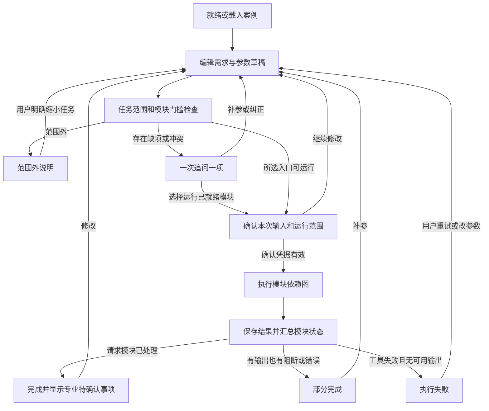

# 03 智能体状态机

版本：v0.2。状态由流程程序管理，大模型不能直接将任务标为完成。单用户页面也要区分草稿、方案快照和一次运行，避免刷新、连续点击或晚到响应覆盖结果。

## 1. 三层状态分别表达

| 层次 | 存放位置 | 解决的问题 |
|---|---|---|
| 交互／执行状态 | draft 和 run | 当前在编辑、补参、确认、运行还是查看结果 |
| 模块状态 | run.module_statuses | 哪些模块完成、阻断或失败；不把“有结果”当“全部完成” |
| 单项核查状态 | rule_results | 条件是否满足、是否缺参或缺依据；不等于软件执行成功与否 |

专业复核是另一独立字段 review_status；模型不可用是 model_mode=fallback，不是计算失败或工程不合格。

## 2. 主流程图

规范文本查询走 B→C→F→检索→J，不要求建立材料计算用的几何快照；可以确认查询条件生成独立 query_context。不存在有效查询条件时先追问。

## 3. 状态与事件转移表

| 状态 | 事件 | 前置条件 | 动作 | 下一状态 |
|---|---|---|---|---|
| IDLE 就绪 | load_case | 数据包有效 | 绑定包、案例、规则清单，建立草稿 revision=1 | EDITING |
| IDLE／EDITING | start_query | 问题文本非空 | 建立无成本字段要求的查询草稿 | VALIDATING |
| EDITING | parse_request | 有自然语言输入 | TL03 提取候选变更；不立即改基准 | EDITING |
| EDITING | accept_patch | expected_revision 匹配 | 应用用户认可的变更，revision+1；旧确认失效 | VALIDATING |
| EDITING | edit_field | 值／清空操作有效 | 保存 raw_value 和 binding_state；revision+1 | VALIDATING |
| VALIDATING | scope_rejected | 明确超出产品范围 | 记录 SCOPE_UNSUPPORTED，不调用当前计算模型 | OUT_OF_SCOPE |
| OUT_OF_SCOPE | narrow_task | 用户明确接受受支持的子任务 | 新建任务草稿，保留原请求及说明 | EDITING |
| VALIDATING | gaps_found | 所选任务有缺项、冲突或非法值 | TL05 只生成一个优先问题；计算可运行模块集合 | WAIT_INPUT |
| WAIT_INPUT | answer | 问题 revision 仍有效 | TL03／表单读取回答，TL04 再校验；未通过继续追问 | VALIDATING |
| WAIT_INPUT | defer | 用户暂不补充 | 保留问题与缺口；允许保存草稿，不自动填值 | WAIT_INPUT |
| WAIT_INPUT | run_ready | 至少一个模块 ready，用户选择部分运行 | 展示本次模块与未决项 | WAIT_CONFIRM |
| VALIDATING | ready | 目标入口或部分运行入口可执行 | 展示参数、来源和计量口径 | WAIT_CONFIRM |
| WAIT_CONFIRM | confirm | draft revision 与展示一致 | TL06 固定快照／query_context，生成 confirmation_token | RUNNING |
| WAIT_CONFIRM | edit | 用户修改任一字段 | 作废确认，增加 revision | EDITING |
| RUNNING | tool_done | 响应 request_id/input_hash 正确 | 保存该模块输出和引用，再标 done | RUNNING |
| RUNNING | tool_blocked | 某模块缺依赖或证据 | 记录 blocked，继续无依赖的分支 | RUNNING |
| RUNNING | tool_error | 工具失败 | 标 error，保留成功结果；不让模型补算 | RUNNING |
| RUNNING | all_settled | 所选模块均已处理或明确阻断 | TL15 模板报告并持久化，汇总完整度 | COMPLETE／PARTIAL／FAILED |
| RUNNING | edit_during_run | 用户修改 | 新草稿 revision+1；旧 run 可完成但只入历史 | EDITING |
| COMPLETE／PARTIAL | export | 指定已持久化 run | TL16 导出；部分结果需显式选择部分报告 | 状态不变 |
| COMPLETE／PARTIAL | revise | 用户修改结果对应参数 | 从快照复制草稿，不修改原 run | EDITING |
| FAILED／PARTIAL | retry | 用户选择重试 | 创建新 request_id/run_id，重新确认范围；固定输入时可复用不可变中间结果 | WAIT_CONFIRM |
| 任意非运行状态 | reload | 本地记录可读 | 恢复最近草稿、版本及状态 | 原状态或 EDITING |

晚到响应只更新其所属旧 run。页面根据当前草稿 revision 和 run.input_hash 决定是否展示为当前结果；与当前输入不匹配时显示历史提示，禁止覆盖。

## 4. 模块依赖与运行门槛

| 模块 | 输入门槛 | 前置模块 | 输出／缺失行为 |
|---|---|---|---|
| query 资料查询 | 查询文本、所选证据集合；已知范围条件 | 无 | 候选证据及适用性缺口；不做方案判定 |
| geometry 基础几何 | 已确认的所需尺寸 | 无 | TL07 按需计算 A、panel_area、nx/ny；每个指标独立记录缺口 |
| length 理论长度 | W/H/b/h、计量模型合法，nx/ny 正整数 | 几何的立面及格数指标 | Lc、Lt、Nc、Rt、Nt；非法布局不计算 |
| mass 质量 | 有效两类规格、正线重 | length | Mc/Mt/M；缺线重保留长度 |
| cost 单方案成本 | 同一基准下两个有效报价，零价有确认 | mass | Cc/Ct/C；缺一价不合计成完整金额 |
| comparison 两方案比较 | 两边成本均就绪，面积／计量／价格口径可比 | 两份 cost | 绝对差、每平方米差、百分比；基准零值只给绝对差 |
| rule_check 辅助核查 | 必查清单、已确认现有参数 | 每项规则按 required_tools 依赖所需几何指标 | 每项必查项产生状态；缺层高仅阻断 R03，不阻断成本 |
| report 报告 | 已保存的结果与 issues | 本次所选模块均 settled | 模板数值与证据、部分完成说明；模型文字可选 |

geometry 按指标计算：panel_area 只依赖 b/h；facade_area 只依赖 W/H；grid_counts 才需要 W/H/b/h 和整除。文本查询不依赖几何；辅助核查 R02 不应因为未填型材或报价被阻断。

组合任务执行顺序：确认快照 → 计算所需基础几何 → 形成并执行全部必查项、同时允许独立材料分支继续 → 汇总。可顺序实现，不要求并发基础设施；依赖关系不得写成“核查全部满足才算成本”。

模块状态：not_requested、ready、running、done、blocked、error。未满足演示或正式条件属于规则判定结果，规则执行本身仍可 done。rule_check 存在待补参数／待核实／未覆盖时模块为 blocked 并保留其他已判定项；需人工判断属于已执行并明确转人工，不伪装为自动判定通过。

## 5. 单项核查状态与判定顺序

规则引擎依序执行：清单项存在性 → 证据来源资格 → 已知适用范围 → 适用性所需字段 → 效力确认 → 可机判性 → 数值输入与依赖 → 条件比较。可确定的不适用直接记录理由；前置条件未知时不跳到真假比较。

| 状态编码 | 用户文字 | 触发条件 |
|---|---|---|
| DEMO_MET | 演示条件满足 | 合法 synthetic 演示规则、适用且输入齐全，条件真 |
| DEMO_ATTENTION | 演示关注项触发 | 同上，条件假 |
| CONDITION_MET | 已满足该条款可机判条件 | 正式／企业依据资格合格、范围效力明确、映射已审核，条件真 |
| CONDITION_NOT_MET | 未满足该条款可机判条件 | 同上，条件假；只描述此条件 |
| NEED_PARAMETERS | 待补参数 | 必需输入缺失、单位不明、非法或未确认；reason_code 区分缺失与非法 |
| NEED_ENGINEER | 需人工判断 | 需要专业判断或当前未实现计算 |
| NEED_VERIFICATION | 待核实 | 已有证据但来源、效力、替代关系或适用性无法确认 |
| NOT_APPLICABLE | 不适用 | 有足够依据确定不在适用范围 |
| NOT_COVERED | 未覆盖 | 没有可靠证据、规则不在库或该问题超出覆盖 |

工具执行失败另存 execution_status=error、status=null、错误原因，显示“核查执行失败”。不能为了凑齐九种业务状态将崩溃伪装成待补参或满足。缺失规则引用在导入阶段通常已被拦截，运行时若文件受损仍需显示 NOT_COVERED 或明确执行错误，不可静默省略。

## 6. 完成度及工程边界

| 总状态 | 判断方式 | 页面表达 |
|---|---|---|
| COMPLETE | 所选入口请求的模块均执行完成；每个必查项有明确结果，没有阻断／工具错误 | “本次运行完成”；同时展示规则关注、转人工事项和覆盖缺口 |
| PARTIAL | 已有可用输出，但请求范围中仍有 blocked/error | “部分完成：质量可用，成本缺报价”等；允许显式导出部分报告 |
| FAILED | 工具失败且本次没有可用输出 | 显示错误和重试入口，不伪造结果 |
| WAIT_INPUT | 尚无可运行的所选模块，需补输入 | 保留草稿和单项问题，不生成运行完成标识 |

演示规则全部执行且成本完整，任务可以 COMPLETE；同时 coverage.formal_clause_count=0，coverage.formal_assessment=not_covered。若用户明确请求正式规范判断，缺正式依据必须输出 NOT_COVERED 并标记相应任务未完成。COMPLETE 不代表规范条件全部满足，更不代表结构安全。

## 7. 确认、降级和不变量

- 提取内容只能进入 pending_patch；输入确认必须来自用户操作，不来自模型自称已确认。
- confirmation_token 绑定 draft_id、revision、输入哈希、所选模块及计量口径；一处变更即失效。
- 同一草稿同一时刻只激活一个追问；专业确认事项列表可以有多项，但不是同时向用户发多题。
- 模型超过 20 秒、返回非法结构或断网时进入 fallback；可用表单和有限本地解析，标明模式。未成功的模型响应不写成已理解需求。
- 计算失败不允许切换成大模型算术；规范缺失不允许切换成模型记忆当正式依据。
- 原版本复算绑定原工具版本；找不到该工具版本时输出 VERSION_UNAVAILABLE，不自动调用新版本。
- 每个成功模块有工具记录、输入哈希和结果引用；每个导出绑定已保存 run。演示身份和来源集合随输出传递。

