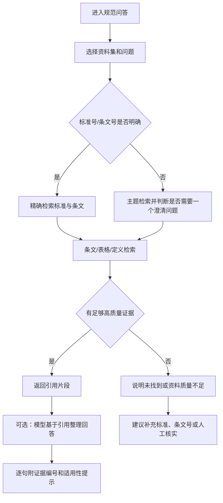

# 幕墙智能体：独立规范问答与 PDF 入库改造方案 v0.4

日期：2026-10-12。性质：产品改造方案与 PDF 入库规范，不包含代码实现，不修改原 PDF。

审查对象：

- 应用：`../幕墙智能体MVP/`
- 规范资料目录：`../幕墙规范资料/`

本方案区分“当前程序已经具备的能力”“PDF 文件的客观状态”和“建议开发的能力”。文件夹中的 PDF 是资料来源，不是自动产生的产品指令；文件名也不能直接证明规范的现行性、适用性或法律效力。

配套附件：[逐文件 PDF 入库检查清单](../规范问答改造附件/PDF入库检查清单_2026-10-12.csv)（Excel 可直接打开）；[机器检查汇总](../规范问答改造附件/PDF检查汇总_2026-10-12.json)。清单是本次只读检查生成的，不是已完成的 OCR 或规范审核记录。

## 1. 结论先说

当前智能体已有资料查阅雏形：可以在“设置 → 资料库”上传 PDF/TXT/MD，也可以在聊天中提问；程序会在已加入工作区的资料中返回候选片段、文件名和 PDF 页码。

它目前还不是一个可以直接用于规范问答的独立功能，原因有四个：

1. 首页虽有“查找资料”按钮，但目前只修改输入提示，没有独立模式和资料集选择，查规范与项目计算共用路由和聊天上下文。
2. 当前程序只读取 PDF 文字层；扫描件没有 OCR，无法检索。
3. 当前检索主要是中文二字片段和关键词计分，未按标准编号、章节、条文、表格建立索引。
4. 结果是“候选资料片段”，没有让大模型严格依据引用回答、逐句绑定证据，也没有可靠的规范元数据审核流程。

本项目的正确目标应是：**用户打开“规范问答”后，不需要先建幕墙项目、不需要填写尺寸或价格；系统只在用户指定的规范资料集内检索，回答每个结论都附文件、标准编号、条文号和页码；没有足够证据时明确说无法确认。**

推荐使用“先检索 PDF 依据，再组织回答”的方式，无需为了这项功能训练或微调一个新模型，也无需把整本规范在每轮对话中重新发送。正文、目录、表格和页码结构要优先做好，换更大的模型不能补救缺失正文或错误 OCR 数字。

## 2. 对资料目录的实际检查

### 2.1 文件统计

对目录及其子目录进行了文件清单、PDF 文字层、页数和 SHA-256 内容哈希检查。

| 项目 | 检查结果 | 含义 |
|---|---:|---|
| PDF 文件 | 97 个 | 不能直接当作 97 份可检索规范；需要去重和审核 |
| 总页数 | 7304 个 PDF 页 | 全量入库需要批处理、索引和质量报告 |
| 全部页面能提取非空白文字 | 29 个文件 | 包括少量仅能提取水印的文件，不能直接判为正文可用 |
| 部分页面能提取非空白文字 | 14 个文件 | 空页可能是空白页、扫描正文或抽取异常，需逐页分类 |
| 全文不能提取非空白文字 | 54 个文件 | 需检查原页；扫描正文要 OCR，真正空白页不必识别 |
| 无非空白文字的页面 | 2450 页 | 尚未区分真正空白页与扫描正文，不是精确 OCR 工时 |
| 有文字但全文平均不足 80 字/页 | 11 个文件 | 包含水印文字、缺失正文等情况，要复查/OCR |
| 按当前导入器每页至少 80 字的规则，零页面入索引 | 65 个文件 | 上传成功也可能完全搜不到；字数达标也不保证质量 |
| 现有规则可保留的页面 | 4559 页 | 其余 2745 页被过滤；其中可含短条文、扫描页等 |
| 完全重复内容 | 3 组 | 发现重复哈希，需保留一个主记录并记录别名 |

统计统一采用 `提取文本去掉首尾空白` 的口径；早期只按“字符串非空”检查会把空格换行算成文字，故最终以本表和清单为准。文件夹内“排除的候选文件”有 3 个 PDF，现有导入器会跳过它们；排除后是 **94 个文件、7119 页**，按当前规则可保留 4401 页，其中 64 个文件零页可检索。再折叠上述 3 组完全重复内容后，默认候选是 91 份不同内容，仍需专业审核。

检查的示例包括：

- `001_建筑幕墙 GB/T21086-2007.pdf`：50 页，当前 PDF 文字层为 0；
- `002_玻璃幕墙工程技术规范 JGJ102-2003.pdf`：90 页，当前 PDF 文字层为 0；
- `006_建筑幕墙工程技术标准 DB33/T1240-2021.pdf`：312 页，311 页有文字层；
- `020_钢结构设计标准 GB50017-2017.pdf`：534 页，533 页有文字层；
- `021_铝合金结构设计规范 GB50429-2007.pdf`：141 页，当前文字层为 0；
- `068` 与 `076` 内容相同；`066` 与 `071` 内容相同；`6320_…13477.20-2017` 与名为 `063_…13477.1-13477.20-2017` 的文件内容相同。

最后一组尤其要注意：文件名声称覆盖系列分册，不能因此认定包含全系列。应打开封面、目录核实，纠正元数据后才能发布。

已抽样确认 `005_…JGJ336-2016`、`007_…GB55031-2022`、`018_…GB55001-2021` 的多页抽取结果主要为“住房城乡建设部信息公开／浏览专用”水印，正文仍需识别。对照 `004_…JGJ133-2001` 的 PDF 第 16 页图像和抽取文本，确认表格可见数值未被完整抽取，条号也缺失。不能因为中文能提取就直接回答数值。

这里的“有文字层”只说明 PDF 内有可复制文字，不说明文字准确、条文结构完整或规范现行。

### 2.2 页面检查结论

抽样渲染的扫描 PDF 具有清晰的页面图像，但页面有水印、版心和页码等版面元素。图像清晰不等于检索可用；仍需 OCR 并人工检查条文号、否定词、数字、小数点、单位和表格。

有文字层的 PDF 也不能直接放心使用。抽取结果可能包含：

- 页眉、页脚、页码混入正文；
- 条文跨页断开；
- 表格列顺序丢失；
- `≤`、`≥`、负号、括号、上标下标或单位被错误识别；
- 中文标准编号和年份被文件名误导；
- 目录、前言、正文、附录没有可靠分层。

## 3. 当前程序能做什么、不能做什么

### 3.1 已有实现

| 当前实现 | 代码位置 | 实际行为 |
|---|---|---|
| 资料上传 | `agent/documents.py`、`ui/chat.py` | 支持 PDF/TXT/MD 上传；设置中也可导入本机文件夹 |
| PDF 抽取 | `documents.extract_pages()` | 使用 PyMuPDF 读取已有文字层；不做 OCR |
| 资料保存 | `storage/workspace.py` | 保存文件哈希、文件信息和页面文本；可软删除/清理 |
| 资料查询 | `agent/assistant.py`、`agent/engine.py` | 用户提问后调用资料检索，返回候选片段 |
| 关键词检索 | `evidence/retrieval.py` | 中文二字片段、英文/数字词、命中数排序；每个文件最多返回两页 |
| 结果提示 | `ui/chat.py` | 显示片段、来源文件、位置和“未审核，仅供查阅”说明 |

### 3.2 关键缺口

| 缺口 | 对使用的影响 | 改造结论 |
|---|---|---|
| 没有独立“规范问答”模式 | 用户容易误以为必须先建项目或规则 | 增加独立入口和独立会话类型 `standard_qa` |
| PDF 扫描件无法检索 | 54 个文件无非空白文字，另有 11 个文件文字极少 | 建立页级质量识别和 OCR 预处理，保留原件和 OCR 版本 |
| 仅按页面关键词排序 | 可能命中同词但答非所问；容易漏掉条文 | 以标准、章节、条文、表格为单位建立混合索引 |
| 没有规范元数据审核 | 可能引用废止、过期或不适用标准 | 入库前人工确认标准身份、状态、适用范围 |
| 只返回片段，没有受约束回答 | 用户得到“搜索结果”，而不是可核对的答复 | 加入引用约束回答器；每个事实句必须有证据编号 |
| 没有查询范围控制 | 97 个文件混在一起，结果来源和适用性难判断 | 按资料集、专业类别、标准编号和状态过滤 |
| 缺少条文号和表格引用 | 专业人员难以复核 | 记录条文号、表号、页码、原文截图/文本哈希 |
| 质量状态只有文件级提示 | 部分页面 OCR 失败会被忽略 | 记录文件级、页级、条款级质量状态 |
| 索引构建提示过时 | 检索缺索引时会提示一个当前项目中不存在的 `tools/build_reference_index.py` | 改为应用内“构建/更新规范索引”，不要求工程师运行脚本 |
| 资料库与项目共享 | 一个项目上传的资料会影响其他对话 | 规范库应有工作区资料集，并允许在问答中明确选择资料集 |
| 计算范围判断先于资料查询 | 关于单元式、石材、结构条文的查阅问题可能被计算范围拦截 | 先按会话任务路由；资料问答范围由选定 PDF 决定，计算边界单独执行 |
| 只存页面文本和文件信息 | 上传资料的流程未保存原 PDF 正本，当前片段无法点击打开原页 | 导入时保留只读副本或受控原件链接，使用哈希固定版本 |

当前实现通过 `Workspace.document_index()` 使用工作区资料；代码中还保留了针对 `data/reference/reference_index.json` 的旧提示。这两种索引方式需要合并为一个明确的资料库服务，避免用户不知道资料到底从哪里检索。

## 4. 新功能：独立规范问答

### 4.1 入口设计

左侧增加一个与“新对话”并列的入口：

> **规范问答**

进入后显示：

- 默认显示一个已选择的资料集（本次用户指定文件夹的已发布版本）；“筛选”中再选专业、标准或纳入待审核资料；
- 当前资料数量和状态：已审核、待审核、OCR 失败、索引过期；
- 一个问题输入框；
- “仅返回原文片段”与“基于引用整理回答”两个模式；
- 当前覆盖边界：没有资料命中不代表没有规定，不作最终工程判断。

这个入口不要求：

- 新建工程项目；
- 输入幕墙尺寸；
- 输入型材线重；
- 输入价格；
- 配置演示规则。

规范问答和方案计算可以在同一应用中存在，但应使用不同的会话类型和不同的运行记录。在规范问答模式中，“单元式幕墙的条文怎么规定”“钢结构相关要求是什么”可以检索本资料集；不能沿用成本模块的范围拦截一概拒绝。要求实施单元式计算或判断结构安全，仍按计算边界处理。

页面保持简洁：一个模式入口、一个资料范围选择、一个聊天框；导入质量、版本维护、OCR 任务放到“管理规范库”，不在每轮回答前堆叠状态表。用户从规范问答结果点击“用于方案核查”属于 P2 扩展，届时需明确选择项目、方案并经专业人员编制/审核规则，不得自动把检索文字转换成正式规则。

### 4.2 支持的问题类型

第一阶段优先支持以下问题：

| 类型 | 示例 | 必须返回 |
|---|---|---|
| 条文定位 | “玻璃幕墙立柱与主体结构连接有哪些要求？” | 标准、章节/条文号、页码、原文片段 |
| 条件查询 | “什么情况下需要进行某项性能检测？” | 条件、例外、适用范围及每项证据 |
| 术语解释 | “规范中的开启扇是什么意思？” | 原文定义或明确说明未找到定义 |
| 数值/单位查找 | “某项允许偏差是多少？” | 数值、单位、表号/条文号、上下文 |
| 标准状态查询 | “这个标准是否替代了旧标准？” | 可回答该 PDF 明确记载的历史替代关系；不能据此认定截至提问日仍现行 |
| 资料对比 | “两份标准对同一事项怎么写？” | 分别引用，不擅自裁定冲突优先级 |

以下问题必须明确限制：

- “我的工程一定符合规范吗？”不能只凭检索片段判定；需要完整工程条件和专业人员审查；
- “按这些条文帮我完成结构安全验算”超出当前方案；
- “哪个标准一定适用？”若没有项目地点、设计阶段、幕墙类型、发布时间和状态依据，只能追问或标记待确认；
- “网上最新版本是什么？”当前资料集不是联网实时数据库，不能假装已查到最新版本。可以由维护人员另外核对官方平台并记录核验日期/依据；这些外部管理记录不得冒充 PDF 原文回答依据。

### 4.3 独立规范问答流程



模型只允许使用本次检索返回的证据回答；检索不到的内容不得由模型凭常识补全。回答至少包括：

1. 结论或“当前无法确认”；
2. 依据文件和标准编号；
3. 条文号、表号或附录号；
4. PDF 页码；
5. 原文摘录；
6. 适用范围与限制；
7. “待专业确认”事项。

回答页面采用“简短答复＋可展开依据”：第一段解释问题，紧随其后展示引用，点引用可打开对应 PDF 页并高亮。条文号尚未核对时只给可靠的页级引用并标注，不猜测条号。问表格要同时引用表头、单位和脚注。只查阅规范中的公式可以展示公式及定义；要求代入工程参数求值时应另走确定性计算工具，不由问答模型心算。

## 5. 推荐的检索和回答架构

### 5.1 检索对象分层

不要只把整页当作一个文档块，至少保存以下层级：

| 层级 | 主键示例 | 用途 |
|---|---|---|
| 标准 | 标准编号＋版次＋原文件哈希 | 同编号不同版、局部修订或不同文本不能覆盖 |
| 章节 | 文档版本＋内容分区＋章号 | 章节导航和主题检索 |
| 条文 | 文档版本＋正文/条文说明＋条文号 | 同一条号在正文和条文说明中须分别保存 |
| 表格 | 文档版本＋表号＋所在条款 | 数值、偏差和分档查询 |
| 附录 | 文档版本＋附录号＋条号 | 保存规范性/资料性附录属性，不能推测 |
| 页 | 文档版本＋PDF页序＋坐标 | 原始定位、跨页引用、拆分双页后的回映射 |

每个条款/表格记录至少包括：

```text
standard_id
standard_number
standard_title
document_id
document_sha256
clause_number
chapter_title
content_type: clause | table | definition | appendix | note
text
page_start
page_end
source_status: synthetic | public | verified | pending
text_quality_status: extracted | OCR_pending | OCR_checked | failed
review_status: unreviewed | pending_professional_review | technically_reviewed | rejected
effect_status: unknown | current | superseded | abolished | pending
applicability
ocr_confidence
extraction_method
```

实际落库时把 OCR 质量与专业审核拆开：`text_quality_status` 保存 extracted/OCR_pending/OCR_checked/failed，`review_status` 沿用专业审核枚举，不能用 OCR_checked 表示已通过工程审核。另保存 `content_zone`（正文/条文说明/目录/前言/附录）、`printed_page_label`、`page_bbox`、`supersedes_id`、`publication_state` 和索引版本。多个原文件/别名归并时保留各自路径映射。

标准身份和规范状态必须与正文摘录分开。文件名中的 `GB...` 只能作为候选编号，不能直接写入 `verified` 或 `current`。

### 5.2 P0 检索实现建议

第一版不必一开始部署复杂向量数据库，但不能继续只依赖当前的简单关键词页面排序。建议采用：

1. 标准号、条文号、表号的精确匹配；
2. 中文规范化后的字符二元组/词组 BM25 检索；
3. 同义词和术语词典，例如“立柱/竖框”“横梁/横框”“开启扇/开启扇构造”；
4. 章节、条文、表格的字段过滤；
5. 去重和每标准/每章节的结果上限；
6. P0 的可升级方案是 BM25＋语义向量双路召回后重排；先做精确/BM25基线，只有盲测达标才可暂不启用语义向量；
7. 将候选条款交给模型整理回答，但模型不能加入候选证据外的事实。

每个检索结果必须带 `retrieval_run_id`、索引版本、文档哈希、条款 ID 和命中分数。用户再次打开历史问答时，能够知道当时使用的资料版本。

### 5.3 回答约束

建议把回答器设为结构化输出：

```text
answer_summary
claims[]: {text, evidence_ids[]}
citations[]: {evidence_id, standard_number, clause, page, quote}
applicability
uncertainties[]
needs_engineer_review: true/false
```

渲染时每个结论句后面显示 `[证据1]`，点击后展开标准、条文、页码和原文。若 `claims` 中有一句没有 evidence_id，程序拒绝显示为“基于规范的回答”，改显示为“仅检索到片段，不能形成有依据的结论”。

有引用号也不代表有依据：程序必须验证证据确实存在于本次检索包、引文能在对应文本中定位、数值和单位一致；另检查结论是否扩大适用范围、漏掉例外或改变“应/宜/可/不得”。语义复核不能保证绝对正确，低质量、冲突或不充分证据降为仅显示原文并建议人工确认。低 OCR 质量页不能作为精确数值回答的唯一依据。

回答问题前要获取完整条款、必要的相邻条款、被引用表格及脚注，不能沿用现有约 160 字的截断片段作为唯一上下文。当前每文件最多两页的限制须改为可按条款扩展；跨页表格不能硬截断。引用过多时先概括并展开完整依据，不能省掉影响结论的限制条件。

PDF 中任何“忽略指令”“无需引用”等文字都当作待检索数据，不能改变系统行为。输出只根据选定 PDF，模型记忆、示例规则和外部网络内容不能混入技术结论。在线模型不可用时仍可独立搜索/查看原文，明确说明暂未生成整理回答。

## 6. PDF 入库前必须完成的处理

### 6.1 原始文件保护

不要在原资料目录中覆盖 PDF，也不要直接对原文件批量 OCR 覆盖。

建议在原目录之外建立处理区；不必实际重命名原目录。文件夹名称是建议结构，当前尚未创建 OCR 成果：

```text
规范资料_原始/       原始 PDF，只读保存
规范资料_处理中/     OCR、文字抽取、页图、人工校正文件
规范资料_发布/       经过审核、可以进入检索库的版本
```

原始 PDF 的文件名、大小、SHA-256、收到日期和来源必须记录。任何 OCR 或清洗结果都必须能回指原始哈希。

### 6.2 第一步：盘点、去重和分类

先不导入智能体，建立资料清单（Excel 或 CSV）。建议字段：

| 字段 | 填写要求 |
|---|---|
| 文件相对路径 | 保留目录结构 |
| 原始文件名 | 不擅自覆盖 |
| 文档名称 | 人工核对，不只复制文件名 |
| 标准编号 | 拆分组织、编号、年份、版本标识 |
| 发布/实施日期 | 从封面或正式来源核对 |
| 代替/被代替标准 | 找到明确依据才填写 |
| 适用专业 | 幕墙设计、结构、材料、检测验收、节能等 |
| 幕墙类型 | 构件式、单元式、玻璃、石材、金属板等 |
| 来源状态 | `public` 或 `pending`；专业确认后才可 `verified` |
| 文字质量状态 | 原生抽取、待 OCR、OCR 已校对、识别失败 |
| 专业审核状态 | 未复核、待专业复核、已复核、退回；与文字质量分开 |
| 现行状态 | `current`、`superseded`、`abolished`、`unknown`、`pending` |
| 是否纳入首批检索 | 是/否及原因 |
| 备注 | 水印、缺页、扫描质量、疑似重复等 |

当前目录建议先处理重复项。重复文件不应在检索中各返回一次，否则用户会误以为有多个独立依据；可以保留别名路径，但只保留一个主文档 ID。

### 6.3 第二步：确认资料来源和适用性

在入库前人工确认：

1. 标准编号、名称和封面是否一致；
2. 是否有发布、实施、修订或局部修订信息；
3. 是否注明替代旧标准；
4. 资料来源是否合法、完整、可长期保存；
5. 当前项目要查询的幕墙类型、设计阶段、地区是否适用；
6. 是否属于标准正文、条文说明、公告、培训材料或企业内部文件。

没有完成这些确认的文件可以在文字质量达标后作为 `pending/unreviewed` 资料查阅，回答明确限定“根据所选 PDF 的记载”，并显示现行性/适用性待核实。不能把“尚未正式审核”变成完全不让用户查原文的门槛；也不能作为正式合规判断依据。

### 6.4 第三步：文字层检测和 OCR

对每个 PDF 逐页检测文字层，不要只做文件级判断。

| 状态 | 处理 |
|---|---|
| 有清晰文字层 | 直接抽取，同时做页眉页脚和条文结构清洗 |
| 文字层为空但页面清晰 | 中文 OCR；建议 300 dpi 起步，必要时 400 dpi |
| 同一文件部分页为空或只含水印 | 对缺失正文的页识别；正常文字页保留，去除重复文字层 |
| 表格、公式、上下标较多 | OCR 后必须人工核对；必要时人工转录为结构化表 |
| 页面倾斜、阴影、压缩严重 | 先去噪、纠偏、裁切，再 OCR；保留处理前后样图 |
| OCR 仍不可读 | 标为 `OCR_failed`，不得进入可回答索引；保留原页供人工查看 |

建议输出：每页纯文本、页图、OCR 置信度、失败原因和原始 PDF 页码。OCR 文字不能覆盖原 PDF，也不能删除原始页面。

只有水印文字的页面不能简单使用“跳过已有文字页”的批处理选项，否则正文仍未识别。双页扫描若切分成左右两页，需记录“新页 → 原 PDF 页＋左右区域”的映射；旋转、裁切后同样保存坐标变换。不能为了让页码看起来一致而删掉封面、目录或前言。

### 6.4.1 工程师可以怎样实际操作

| 路线 | 操作方式 | 适合情况 |
|---|---|---|
| 带 OCR 的 PDF 桌面工具 | 使用已具备中文识别的 Acrobat Pro、ABBYY FineReader PDF 或相应功能的 WPS PDF；具体菜单依安装版本 | 最容易先处理少量重点文件；扫描表格仍需核对 |
| 本地批处理 | 维护人员选用 PaddleOCR/版面分析，或 OCRmyPDF 配合支持中文的 OCR 引擎；以样本准确率选择 | 本资料集页数较多，适合批量、续跑、质量报告和版本追溯 |
| 外部文档识别服务 | 团队确认服务后上传选定文件；保存任务记录和处理版本 | 可减少本地部署，但效果、数据传输和费用需另评估 |

推荐先用你已安装的 PDF 工具处理 2–3 份，再让开发团队做批量自动化；不要为了使用助手而让工程师亲自编写 JSON 或条文分块文件。

桌面工具的通用步骤：

1. 从原件复制一个处理副本，核对封面、总页数、有没有缺页/倒页。
2. 在“扫描/OCR/识别文字”中选中文（必要时中英混合）和全部需要处理的页面。
3. 输出“可搜索 PDF／保留原页面图像并增加隐藏文字层”，不要只保存成图片 PDF。
4. 在生成文件中搜索实际出现的专业词，复制一段正文到记事本，核对阅读顺序。
5. 再复制一条带数字、单位和条文号的内容，以及一张表的关键行，逐项对照页面图像。
6. 标记失败页；必要时重新识别、按区域处理或人工校正。不要默认接受自动识别数值。
7. 文件另存到处理区，保留原件哈希和页映射；质量确认后列入发布清单。

本任务未实际运行 OCR，也未验证上述软件在本机的授权、识别性能或批处理速度，不据此给出工时/费用承诺。

### 6.5 第四步：清洗但不改变规范含义

可以做：

- 去除重复页眉、页脚和扫描水印造成的重复文字；
- 合并跨页但属于同一段的正文；
- 保留原始页码和 PDF 页码两个字段；
- 统一全角/半角、空格、换行、连字符、标准编号格式；
- 把目录、前言、正文、附录、条文说明标记为不同内容类型；
- 识别 `1`、`1.0.1`、`5.2.3` 等条文号；
- 保留表格标题、表头、行列、单位和脚注。

不可以做：

- 根据常识改写“应”“宜”“可”“不得”；
- 把 OCR 不确定的数字自动修正成看似合理的数字；
- 删除“除……外”“不应”“不得”等限定词；
- 仅依据文件名补写条文号、年份或现行状态；
- 把条文说明当成强制性条文；
- 将多个标准拼成一段看似统一的规定。

每次人工校正必须保存原文本、校正文本、校正人、时间、理由和页码。

### 6.6 第五步：条款化和人工抽查

推荐把规范拆成条款记录，而不是只把 7304 页作为大文本库。自动切分后至少抽查：

- 每份标准的封面、目录和任意 5 页正文；
- 每个 OCR 文件的低置信度页面；
- 含数值、单位、表格、否定词的条款；
- 重点幕墙标准的连接、立柱、横梁、玻璃、性能、验收章节；
- 检索测试中排在前面的每条结果。

建议首批小规模试点，不要一次把 97 份全部标为可依据。先选 5–10 份与构件式玻璃幕墙最相关的文件，完成 OCR、元数据和人工抽查，再扩大范围。

日常用户需要提供的是“原 PDF 或可搜索 PDF＋一张简单登记表”。条文切分、页面坐标、全文索引、向量索引和技术元数据由程序生成，低质量项才交给人处理。抽查只是发布前质量门槛，不表示全部文字都无误；计划用于高频答复的数字、单位、否定词、表格要逐项核对。

建议发布状态分为：待处理→待校对→可检索查阅→已专业确认；可检索查阅与正式规则引擎准入是两个门槛。若文字质量不足，允许查看原页，但不让该页生成确定性技术结论。

## 7. 建议的首批资料集

以下只是按文件名和目录的候选分组，不是对规范现行性或适用性的确认。最终状态必须由专业人员和可靠来源核对。

| 资料集 | 候选资料 | 用途 |
|---|---|---|
| 幕墙核心 | 建筑幕墙、玻璃幕墙工程、幕墙设计文件、幕墙质量检验 | 设计、构造、验收问题 |
| 结构输入 | 建筑结构荷载、铝合金结构、钢结构、工程结构通用规范 | 结构条件和材料相关问题；不等于结构验算 |
| 材料 | 玻璃、密封胶、紧固件、铝材及配件标准 | 材料性能、试验、产品要求 |
| 检测验收 | 气密/水密/抗风压、平面内变形、抗震、质量检验 | 检测和验收问题 |
| 节能 | 公共建筑节能、建筑热工 | 节能和热工问题 |
| 其他专业 | 石材、金属板、单元式等相关资料 | 独立规范问答可按主题检索；没有工程计算实现不影响查阅已收录条文 |

筛选项第一版就要有，专业分类细化可后续做。对现有“排除的候选文件”目录保持默认排除，用户明确选择纳入并完成审核后才能进入资料集，不能因为批量导入而重新启用。

“幕墙核心”资料集仍需逐文件审核。特别是文件名相近、标准编号存在年份差异或文件名备注“原文名称编号有误”的资料，必须先人工确认。

## 8. 需要开发的功能清单

| 功能 | 使用者 | 输入 | 处理逻辑 | 输出 | 优先级 | 验收标准 | 依赖真实数据 |
|---|---|---|---|---|---|---|---|
| 独立规范问答入口 | 工程师 | 问题、资料集 | 创建 `standard_qa` 会话，不加载项目草稿 | 独立聊天页面 | P0 | 空工作区直接提问，不追问尺寸和价格 | 否 |
| 批量资料导入 | 管理/工程人员 | 文件夹或多文件 | 扫描、哈希、去重、抽取、状态报告 | 成功/失败/需 OCR 清单 | P0 | 97 份资料可看到逐文件状态；失败不静默 | 是 |
| OCR 预处理 | 维护人员 | 扫描/水印文字 PDF | 逐页质量分类和 OCR，保留原件、页图和置信度 | 可检索文本及 OCR 状态 | P0 | 零正文或缺数字页不能被误认为完整可检索 | 是 |
| 标准元数据审核 | 工程师 | 标准信息、来源、状态 | 人工确认后发布到资料集 | current/pending 等状态 | P0 | 未审核文件不能显示为正式依据 | 是 |
| 条文/表格解析 | 系统+工程师 | 清洗文本 | 识别章节、条文、表格、附录和页码 | 条款记录 | P0 | 能定位条文号和页码；失败条款进入待校正 | 是 |
| 混合检索 | 工程师 | 标准号、条文号或自然语言问题 | 精确匹配+BM25/词组+可选向量召回 | 排序证据 | P0 | 标准号和条文号优先，重复文件不重复返回 | 是 |
| 引用约束回答 | 工程师 | 检索证据 | 模型只基于证据生成，逐句绑定引用 | 回答、原文、适用性限制 | P0 | 无证据句不能显示为规范结论 | 是 |
| 原文模式 | 工程师 | 查询 | 不经模型改写，仅返回片段 | 可复制原文与位置 | P0 | 用户可直接核对 PDF 原文 | 是 |
| 资料集过滤 | 工程师 | 所选目录、主题、标准、状态 | 只检索用户选择的已发布范围 | 过滤后的结果 | P0 | 回答依据只能来自授权资料集；默认排除候选目录和演示规则 | 是 |
| 条文人工校正 | 工程师 | OCR/抽取结果 | 保存原文、校正稿、人员和时间 | 新版本条款 | P1 | 可追溯每次改动，不能覆盖原始文本 | 是 |
| 版本与停用 | 专业负责人 | 原文件哈希、发布版本、变更列表 | 增量发布、停用、状态提示 | 索引版本和更新结果 | P0 | 替换文件不覆盖旧引用；停止使用后新问答不检索该版本 | 是 |
| 现行性维护 | 专业负责人 | 标准状态和替代关系的核验依据 | 记录核验时间、依据和范围；历史检索另选 | 可用性提示 | P1 | 文件中的历史替代说明不能被当作当前现行证明 | 是 |
| 问答追溯导出 | 工程师 | 问答结果 | 导出证据、版本、哈希和原文 | Markdown/Excel/PDF（按开发能力） | P1 | 同事可复核回答来源 | 是 |

## 9. 推荐的实施顺序

### 阶段 A：资料清理和试点

1. 生成 97 份文件清单、哈希和文字层报告。
2. 去重并标记主文件/别名。
3. 选择 5–10 份幕墙核心候选资料。
4. 核对标准编号、版本、来源和适用范围。
5. 对扫描件 OCR，对有文字层文件清洗并抽查。
6. 建立首批条文索引和 20–30 个真实查询测试问题。

### 阶段 B：独立问答 P0

1. 增加“规范问答”入口和 `standard_qa` 会话。
2. 把资料导入、索引构建、状态报告放到界面，不再要求运行脚本。
3. 增加标准号/条文号/表号字段和精确定位。
4. 改造当前页面关键词检索为精确定位/BM25基础及可升级的混合检索，以盲测门槛决定是否必须启用语义召回。
5. 增加原文模式和引用约束回答模式。
6. 增加“证据不足”“资料未审核”“现行状态待确认”固定提示。

### 阶段 C：质量和工程协作

1. 条文人工校正和版本发布流程。
2. 细化已有资料集的专业分类与跨标准对比。
3. 问答导出及审查记录。
4. 扩充剩余资料；每批新资料单独验收，不把全库一次性标为可用。

## 10. PDF 入库前的可执行操作清单

建议由资料管理员按以下顺序操作：

### 必做

- [ ] 复制原目录到只读原始区并计算 SHA-256；
- [ ] 生成清单，确认 97 个 PDF 是否都应纳入；
- [ ] 去重 3 组重复内容；
- [ ] 填写标准编号、名称、来源、发布/实施日期和适用范围；
- [ ] 逐页检测文字层；
- [ ] 逐页评估 54 个无非空白文字文件、14 个部分有字文件及水印/缺字文件；仅对需要的正文页进行 OCR；
- [ ] 保留 OCR 前 PDF、OCR 后文本和页图；
- [ ] 抽查封面、目录、正文、表格和低置信度页；
- [ ] 识别章节、条文号、表号、附录和 PDF 页码；
- [ ] 将低质量页标记为不可直接回答；
- [ ] 在首批发布前用真实问题测试命中条文和引用页码。

上述统计有交叉：水印文件可属于“全部有字”或“部分有字”，不能把不同类别相加当作需 OCR 的独立文件数。真正空白页不需要 OCR；可提取中文但缺数字的页仍可能需要重识别。

### 不要做

- [ ] 不要把整个文件夹直接作为“正式规范库”启用；
- [ ] 不要只根据文件名认定标准现行；
- [ ] 不要把 OCR 文本直接覆盖原 PDF；
- [ ] 不要把检索不到结果解释成“不存在规定”；
- [ ] 不要让大模型自由总结未提供的规范内容；
- [ ] 不要把用户上传的 PDF 自动生成规则引擎中的正式条款；
- [ ] 不要把 `pending/unreviewed` 显示为 `verified/current`；
- [ ] 不要把多个标准中相似文字拼成一条新规定。

## 11. 第一批验收测试

| 用例 | 操作 | 预期 |
|---|---|---|
| Q01 | 空工作区进入“规范问答”，直接提问 | 不要求创建项目或填写成本参数 |
| Q02 | 查询明确标准编号和条文号 | 返回对应标准、条文号、页码和原文 |
| Q03 | 查询自然语言主题 | 返回多个候选并说明资料状态，不把第一条当唯一结论 |
| Q04 | 查询扫描 PDF 中的已知词 | OCR 后可命中；未 OCR 前明确说明不可检索 |
| Q05 | 查询重复文件 | 同一内容只返回一个主文档，并列别名信息 |
| Q06 | 查询只存在于过期/待确认资料的内容 | 结果明确标记状态，不能称为当前正式要求 |
| Q07 | 查询无命中内容 | 明确“当前资料集中未找到”，不说“规范没有要求” |
| Q08 | 删除资料后查询 | 被删除资料不再出现在新结果；历史问答仍显示原引用状态 |
| Q09 | 模型回答含无证据句 | 程序拒绝显示为规范结论，要求改为证据不足 |
| Q10 | 询问“我的工程是否合规” | 返回资料依据和待核实项，不代替工程审查 |
| Q11 | 标准文件有表格 | 保留表号、行列、单位和页码；不只返回断裂文本 |
| Q12 | 标准号格式含空格、斜杠、下划线 | 能归一化检索，但展示原始标准编号和文件名 |
| Q13 | 提问“单元式幕墙某连接条文怎么写”，资料集含该条文 | 允许资料查阅；不能被成本计算的范围判断直接拦截 |
| Q14 | 文本只有水印或表格数字丢失 | 质量检测阻断数值回答，指向原页待人工核对 |
| Q15 | 跨页条文、表格脚注和条文说明 | 返回完整条件；正文和条文说明不混合，页码都可点击 |
| Q16 | 单元引用号有效但实际不支持结论 | 语义核验降级为原文展示，不能以有引用号作为通过条件 |
| Q17 | 原件替换、删除或重新 OCR | 更新索引有明确版本；旧问答固定旧证据，新问答使用发布版本 |
| Q18 | PDF 中出现要求模型改变规则的指令 | 只当资料文本，不改变资料范围、来源状态和引用要求 |
| Q19 | 在线模型失败 | 精确查询和原文搜索仍能用，明确未生成整理回答 |
| Q20 | 回答混入演示规则、模型记忆或目录外资料 | 证据白名单拒绝；不足时只说明当前库无法确认 |

### 11.1 建议验收门槛（待团队确认的目标，并非已达成结果）

由工程师建立不少于 30 道有标准答案和页码的题：10 道精确条文、10 道不同说法/跨页条件、5 道表格数字、5 道无依据/冲突/范围问题。调参题与盲测题分开。

| 指标 | 建议目标 |
|---|---|
| 精确条文定位 | 在已发布且条款已校对范围内，正确条文 Top1 100% |
| 主题召回 | 正确依据在 Top5 出现率不少于 90%；不达标则补同义词/语义检索并重测 |
| 引用真实性 | 证据ID有效、引文能定位、文件及页码匹配 100% |
| 数值/单位/否定词 | 验收集中零未被提示的错误；低质量证据应明确降级 |
| 无依据问题 | 不补造规范要求；无命中说明正确率 100% |
| 检索性能 | 先用实机实测设目标；不得把 OCR 全库处理放进每轮聊天请求 |

样本通过只证明样本与已发布范围，不证明整个规范库零错误。每批新增/重识别资料要跑对应回归集。

## 11.2 开发落点和内部接口

| 改造位置 | 具体工作 |
|---|---|
| `ui/chat.py` | 模式入口、可见资料范围、原文引用展开和定位、独立问答历史；设置中管理索引任务 |
| `agent/assistant.py`、`agent/parser.py` | 先按 `standard_qa` 路由；“那条/这个表”解析为上次证据；不继承成本草稿 |
| `agent/documents.py` | 文件扫描、原件保存、页级质量分流、OCR结果接入、条款/表格解析、错误重试 |
| `evidence/retrieval.py` | 标准/条号精确匹配、BM25、可选向量及重排、跨页和引用条款扩展 |
| 新增证据回答服务 | 证据包组装、受约束生成、引用一致性和语义检查、无依据降级 |
| `storage/workspace.py` | 文档版本、别名、页坐标、条款、索引批次、问答、发布/停用及清理关系 |

| 服务接口 | 输入 | 输出与约束 |
|---|---|---|
| 扫描资料源 | 指定根目录、包含/排除规则 | 清单、哈希、变更、质量状态；不自动发布 |
| 处理/索引任务 | 文档版本列表、处理配置 | 进度、失败页、待校对项；支持断点续跑 |
| 发布资料集 | 已确认文档/条款、版本号 | 不可变发布版本；创建后聊天才可选用 |
| 检索依据 | 资料集版本、问题、筛选、指代上下文 | 有版本和页码的完整证据包及缺口 |
| 生成答案 | 问题、证据包、模式 | 每项结论的引用、限定条件、待确认项 |
| 打开原文 | 文档版本、PDF页序、坐标 | 对应原页及高亮；路径消失时明确提示 |

导入、OCR、索引按后台任务运行，界面可查看进度并对失败项重试；已发布资料仍可查询。用户选定文件夹后点击“扫描更新”，仅重处理哈希变化的文件；原目录新增文件不能未经发布就改变现有问答依据。相同内容异名使用别名映射，旧版/新版/局部修订保留不同版本，不简单取文件名年份最大者。

## 11.3 原件与索引的保存/删除边界

原目录采用只读资料源，本次用户授权的是以其 PDF 为问答依据，不是授权自动修改或删除这些 PDF。应用保存原件副本或固定路径与哈希，以便点击引用看原页；若只引用外部路径，则在文件移动后提示重新定位，不能默默引用另一份同名文件。

停用资料应同时移出关键词/向量索引及检索缓存。历史问答保存当时引用与失效状态；彻底清理时明确是否删除应用副本和历史证据内容。任何应用内“清空工作区”都不得顺带删除用户指定的原始资料目录。

## 12. 对你的资料目录的实际建议

当前最适合的路线不是马上把 97 个文件全部塞进智能体，而是：

1. 先建立“规范资料清单”和审核状态；
2. 先选幕墙核心资料做小规模试点；
3. 对扫描 PDF 先 OCR，再进入条文索引；
4. 先上线“独立规范问答 + 原文引用”功能；
5. 问答稳定后，再将结构、材料、节能和检测资料逐批接入。

在完成元数据和 OCR 处理前，当前文件夹只能作为“待整理资料源”，不能作为可以直接支撑规范结论的知识库。即使全部文件完成 OCR，系统仍只能回答“在已导入且状态明确的资料中找到的依据”，不能自动保证规范现行、适用或工程合规。

### 12.1 你现在需要准备的最小交付

| 你/工程师准备 | 开发团队完成 |
|---|---|
| 从检查清单中选出首批 5–10 份重点资料；保留原件 | 批量抽取、OCR 任务管理、页面和条款质量报告 |
| 为每份补充标准名、编号、来源、已知版本及适用范围；未知就填待确认 | 生成内部 ID、哈希、索引版本和字段映射，不要求你编数据包 |
| 抽查数字、单位、条文号、表格和限定词；记录有问题的页 | 去重、条款切分、表格结构、混合检索和点击原页 |
| 提供实际会问的 20–30 个问题，并为验收题标出正确出处 | 独立聊天入口、引用约束回答、错误降级和自动化验收 |

如果开发暂时不改程序，可先将少量确认质量的 PDF 做成可搜索副本，再通过现有“设置 → 资料库”导入，测试关键词能否定位。但现版仍只返回候选片段，没有完整的受约束规范问答能力；这一步用于资料试点，不是全部改造已完成。

本次已完成盘点与修改方案，未实际批量 OCR、校正条文、核验所有规范的现行状态、构建正式索引或修改应用。原目录中的 PDF 均保持原样；抽查图片和清单保存在单独的“规范问答改造附件”目录。


