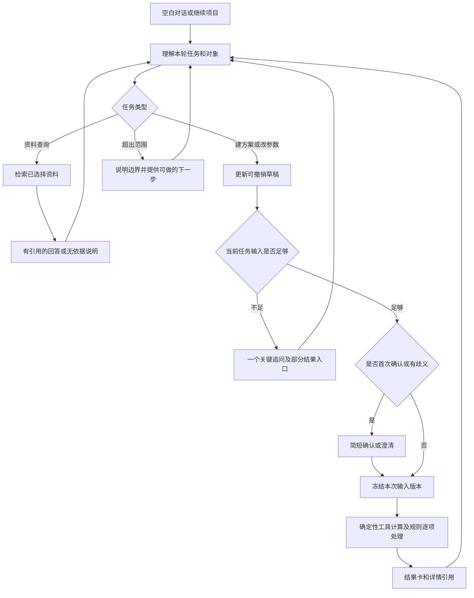

# 幕墙智能体：聊天式交互与空白启动改版方案 v0.3

日期：2026-10-11。交付性质：产品与开发修改方案，不包含应用实现代码。

审查对象：`../幕墙智能体MVP/`。

**建议把产品改成“从空白开始、通过对话建立方案、按需查看计算依据”的工程助手。保留确定性计算和追溯能力，重做入口、数据录入、上下文管理与数据生命周期。**

本次进行了源码检查、临时数据库中的隔离流程验证和独立算例计算。没有修改应用代码、现有项目、模型配置或业务数据库，也没有完成浏览器视觉验收或在线模型实测。以下区分已经确认的问题、源码显示的风险和拟议设计。

## 1. 对这次修改目标的理解

用户应当能够打开一个没有案例的智能体，直接输入自己的方案；系统根据任务逐步补齐参数，计算并展示结果。用户可以使用自己编造的数据测试，但测试案例必须由用户主动建立，不能由程序自动装入。

### 1.1 对五项反馈的具体回应

| 用户反馈 | 本次修改决定 | 完成后的表现 |
|---|---|---|
| 界面杂乱，不知道功能是什么 | 将五页操作台改为一个聊天主界面；参数、材料、依据、历史详情按需展开 | 进入后能看懂“描述方案、比较用量和材料金额、查找已上传资料” |
| 不会制作数据包 | 自然语言、粘贴表格、简短表单和普通 Excel 导入统一到同一个草稿 | 用户不需要知道 JSON、manifest、外键或数据包版本 |
| 希望像主流 AI 一样聊天 | 一个输入框贯穿建项目、补参、改方案、看结果和追问 | 不再分别寻找“调整输入框”“缺参回答框”和多个执行页面 |
| 内嵌演示数据无法删除 | 新安装零业务数据；删除自动装载入口；支持项目删除、回收站和彻底清理 | 清空后重新启动仍然为空；所有材料和数值由用户录入或主动导入 |
| 简洁美观 | 以文字对话和紧凑结果卡为主；限制主屏信息密度 | 默认不展示哈希、状态枚举、调试开关和长参数表 |

这里的“空白”指没有项目、方案、材料、报价、演示规则、历史结果和参考资料。产品帮助、单位换算规则、计算公式以及空白模板属于系统能力，可以保留。既有用户资料的迁移另行处理，不能在升级时自动清除。

### 1.2 与原设计的关系

原 v0.1/v0.2 方案偏重可演示和可复核，采用了五页布局、完整参数表、预设案例和技术数据包。这些设计本身也需要修订，不能把问题全部归因于开发实现。

本方案替代原设计中的“预设案例作为默认入口”“技术数据包作为主要录入方式”“技术追溯信息常驻主界面”等交互决定。业务范围继续保持：构件式玻璃幕墙、单矩形等距立面、铝合金立柱与横梁的理论轴线用量及材料金额。

不在本次改版中增加 CAD、单元式幕墙、完整结构计算、玻璃成本、加工损耗、安装造价或工程签审。非整除分格和复杂立面仍需清楚说明范围，不能为了让流程跑通而修改真实参数。

## 2. 实际问题与根因

### 2.1 已确认的问题

| 编号 | 发现与证据 | 使用影响 | 修改要求 |
|---|---|---|---|
| U01 | [ui/common.py](../幕墙智能体MVP/ui/common.py:32) 初始化工作流时调用自动演示装载；[workflow.py](../幕墙智能体MVP/agent/workflow.py:69) 在没有活动数据时启用内置包。隔离验证中，空库执行初始化后产生一个演示数据集 | 用户不能获得真正的空白环境；仅删除数据还可能再次装载 | 普通启动路径不得调用演示初始化；空库是正常可用状态 |
| U02 | [workflow.py](../幕墙智能体MVP/agent/workflow.py:144) 载入时使用 PRESETS 的 S0。隔离验证：合法数据中将基准 ID 更名后，校验通过，载入报 `KeyError 'S0'` | 数据看似可以替换，实际工作流仍依赖固定编号 | 基准由当前项目的实际方案选择；运行逻辑不得依赖 S0/S1 等编号 |
| U03 | [questions.py](../幕墙智能体MVP/agent/questions.py:45) 的型材追问固定提供 COL-A/COL-B、BEAM-A/BEAM-B | 用户自己的材料没有正常入口，空库时也无法开始 | 从当前项目及用户明确选择的材料库获取选项，支持现场新建 |
| U04 | [ui/pages.py](../幕墙智能体MVP/ui/pages.py:90) 主要导入入口只收复杂 JSON 包 | 工程师需要先理解程序的数据结构 | 增加自然语言、粘贴、简表和 Excel 适配；复杂数据包降为维护用途 |
| U05 | [ui/pages.py](../幕墙智能体MVP/ui/pages.py:143) 参数表包含来源等九列并固定占用 600px；结果页先展示大表 | 主要任务被技术信息淹没 | 主屏先显示结论、差值和下一步；完整表格进入详情 |
| U06 | [extraction.py](../幕墙智能体MVP/agent/extraction.py:349) 给模型的输入是基准参数、当前追问字段和本轮文字，没有当前候选状态与历史对话 | 已显示的聊天记录不等于模型拥有连续上下文 | 引入明确会话对象、当前方案、最近相关消息和上次结果引用 |
| U07 | [workflow.py](../幕墙智能体MVP/agent/workflow.py:348) 将修改过的字段再次改值列为冲突。隔离验证中，先改为 1.5m，再改为 2m 触发额外冲突确认 | 正常反复试方案也需要反复确认 | 明确的后续更正直接更新草稿并可撤销；真正歧义才追问 |
| U08 | [ui/pages.py](../幕墙智能体MVP/ui/pages.py:203) 无草稿时只提供载入内置案例；正常流程需要识别、应用、确认、切页 | 不支持从零建方案；操作链过长 | 用户发送消息后自动整理草稿，首次运行集中确认一次 |
| U09 | [storage/repository.py](../幕墙智能体MVP/storage/repository.py:62) 和当前页面未提供项目删除、回收站或彻底清理入口 | 试错数据越积越多；无法回到空白状态 | 增加完整数据生命周期，清楚区分撤销、删除与彻底清理 |
| U10 | [workflow.py](../幕墙智能体MVP/agent/workflow.py:119) 按当前包是否演示决定会话输入的来源身份 | 在演示包中录入真实值仍可能标为 synthetic | 来源逐字段记录；用户输入身份不能由当前数据包强行决定 |
| U11 | [ui/pages.py](../幕墙智能体MVP/ui/pages.py:114) 未建参考索引时让用户运行脚本 | 工程师仍需接触开发操作 | 上传资料后由系统解析、索引并报告状态 |
| U12 | [reporting/export.py](../幕墙智能体MVP/reporting/export.py:16) 当前面向用户的交付为含 MD/CSV/JSON 的 ZIP | 结果不便于直接转交同事复核 | 主入口提供 Excel 比选表；技术追溯包进入更多选项 |

计算模块使用几何、长度、质量和成本公式；现有代码并非简单返回写死的金额。应当保留这些计算能力，解除上层工作流与预设数据的绑定。

### 2.2 其他需要处理的使用风险

| 风险 | 依据与判断边界 | 修改要求 |
|---|---|---|
| 打开错误项目或旧结果 | `current_draft()` 会回退到全局最新草稿，`selected_run()` 会回退到全局最新运行；源码显示存在串项目风险，本次未实测多会话串用 | 每个对话绑定明确的项目、方案和运行；找不到记录就显示空态，不取别的项目兜底 |
| “原方案填错了”难以修正 | 当前界面把基准设为只读，主要编辑候选 | 支持“修正原方案”生成新的基准版本；旧结果保留并标注采用旧基准 |
| “一米五”“再增加 100 毫米”难以理解 | 当前抽取校验要求数值字面出现在原文中；存在语义归一化与相对修改风险，尚未在线实测 | 模型提取含义与原文证据；单位换算、相对值运算由工具执行 |
| 模型可用性提示过于乐观 | 当前可用性判断主要检查依赖和凭据，不等于本次请求成功 | 根据最近真实请求展示状态；失败时保留输入并提供表单继续 |
| 为满足软件而改工程数据 | 非整除提示要求改成可整除尺寸 | 先解释当前模型不支持边跨；允许保留真实尺寸、补充资料或结束该计算 |
| 修改后仍把旧结果当作当前结果 | 对话化后若不绑定版本，旧卡片易被误读 | 变更后标记“参数已修改，以下为上次结果”；新结果生成后明确对应版本 |
| 导入错误难定位 | 技术字段、错误码、来源字典直接面向使用者 | 解释成具体文件、工作表、行、列和可执行的修正动作 |
| 可用性不等于工程覆盖 | 界面变简单后可能弱化对正式规范覆盖和材料金额范围的理解 | 结果卡保留必要范围和覆盖提示，禁止用“全部合规”“结构安全”作结论 |

## 3. 新的信息架构与界面原型

### 3.1 一张主界面，三类按需详情

| 区域 | 默认内容 | 进入方式与行为 |
|---|---|---|
| 可收起的左栏 | 新对话、最近项目/对话；底部设置 | 不再显示 P01—P05 或开发模块名称；条目支持重命名和移入回收站 |
| 主对话区 | 用户消息、助手追问、简短参数确认、结果卡 | 阅读顺序按对话时间；不固定放置多张表格 |
| 底部输入区 | 一个输入框、附件按钮、发送按钮 | Enter 发送、Shift+Enter 换行；补参也在这里完成；处理中可停止 |
| 方案详情 | 当前项目、原方案/候选方案、几何、材料与报价 | 点击“查看参数”按需展开；支持同屏批量编辑并保存 |
| 计算与依据 | 参数来源、公式步骤、规则逐项状态、引用原文 | 从对应结果卡进入，不占据初始页面 |
| 项目资料 | 上传文件、材料、报价、版本及删除状态 | 从项目菜单或附件管理进入；按项目隔离 |

“详情”可在 Streamlit 版本中使用原生弹层、折叠区域或独立详情视图实现；不要求为了仿制抽屉而使用容易失效的页面样式补丁。

### 3.2 空白首页

主标题：**幕墙方案助手**。

说明：**描述你的方案，我可以整理参数、计算立柱横梁理论用量，并比较材料金额。**

三个轻量入口：“录入一个方案”“比较两个方案”“查找资料”。它们只改变输入提示或打开空白录入，不创建任何示例数据。

输入提示：“输入方案尺寸、材料信息或你想调整的内容，也可以粘贴表格。”

页底简短范围提示：“当前支持矩形等距构件式幕墙；结果供方案辅助，不作安全验算或工程签审。”详细范围可以展开查看。

首页不显示案例编号、模型供应商、数据库版本、数据包统计、核查状态矩阵、大面积告警或空白参数表。参考资料为空时，也不在首页堆叠错误提示；用户实际查询时再解释。

### 3.3 建立方案时的对话

用户：

> 建一个手工测试案例，矩形构件式玻璃幕墙，没有洞口。宽 18 米、高 6 米，分格宽 1.2 米、高 1.5 米。先算型材用量。

助手：

> 已建立“手工测试案例”，数据标为演示数据。按包含左右边柱、顶底横梁的理论轴线模型，可以先计算长度；计算质量还需要型材线重。立柱每米多重？

同时提供一个次要操作：“先看长度”。用户可以一次回答立柱、横梁两种线重；系统必须全部吸收，不能机械地重新追问已提供的内容。

若用户只说“建一个方案”，先询问当前任务或幕墙类型；不能自动补入预设几何。只查资料时，不建立空项目，也不追问型材价格。

### 3.4 改参及结果卡

用户：

> 把分格宽度改成 1.5 米，其他不变，算一下与原方案的差别。

助手先显示可撤销的变更摘要：“分格宽度 1.2 → 1.5m；其余参数沿用当前原方案。”

完成后默认结果卡只包含：

| 展示项 | 本文手工测试案例的示例内容 |
|---|---|
| 一句话结论 | 已覆盖型材材料金额减少 1,215.00 元，下降 12.45% |
| 小型对照表 | 原方案 9,756.00 元；调整方案 8,541.00 元；理论质量 376.200 → 327.600kg |
| 解释 | 在本计量模型及材料不变的条件下，立柱总长减少，横梁总长不变 |
| 必要标记 | 演示数据；仅立柱横梁理论材料金额；未执行正式规范核查 |
| 后续入口 | 查看计算依据、下载比选表；更换材料可继续在输入框中提出 |

不能将上述示例预装进正常应用。这只是本方案的手工验收数据，数值须在用户完成录入后由计算工具生成。

### 3.5 视觉与交互标准

| 项目 | 建议规格与验收要求 |
|---|---|
| 页面宽度 | 对话正文最大宽度约 840px；宽屏留白，避免文字铺满整屏 |
| 字体 | 使用清晰的中文系统字体，正文约 16px、行高约 1.6；关键金额使用等宽数字 |
| 配色 | 浅色中性背景配一个低饱和强调色；警告色只表示需要处理的问题 |
| 密度 | 主屏默认不出现超过 5 行的参数摘要；完整内容通过详情查看，不能丢弃 |
| 图标与边框 | 使用统一线性图标；减少彩色 emoji、多重描边、阴影和卡片嵌套 |
| 消息呈现 | 用户与助手区分明确；助手用短段落，计算结果用小表格，不显示技术 JSON |
| 状态 | 显示“正在整理参数 / 正在计算 / 正在查找资料”；完成后收起，不永久占据主屏 |
| 自动滚动 | 用户向上阅读时不强制拉回底部；显示“有新结果”入口 |
| 可访问性 | 键盘可完成发送、选择和确认；焦点清楚；状态同时有文字，不能只靠颜色 |
| 桌面验收 | 在 1366×768 和 1920×1080 下，首页可看到输入框；主页面没有横向滚动 |

## 4. 从工程师习惯出发重做录入

### 4.1 四种等价入口

| 入口 | 用户动作 | 系统处理 | 优先级 |
|---|---|---|---|
| 自然语言 | 描述尺寸、材料、价格和调整要求 | 提取为结构化候选，显示摘要，按当前任务补缺项 | P0 |
| 粘贴表格 | 从 Excel 复制几行参数或材料清单到输入框 | 识别表头、单位和数值；歧义按具体列询问 | P0 |
| 简短表单 | 点击“填写参数”，一次编辑多个字段 | 直接校验并更新同一个草稿；不会另建一套状态 | P0 |
| Excel/CSV | 上传自己的简单表格，或使用空白模板 | 自动识别常见列名，预览映射后导入；不要求特殊编号 | P0 |

Word/PDF 作为参考资料上传和检索列为 P1。自动从复杂工程 Word/PDF、扫描表格、照片中可靠建立完整可计算方案，不作为本轮 P0 承诺。附件菜单需说明当前支持的用途，避免“能上传”被理解为“任何内容都能算”。

### 4.2 不再要求用户制作完整数据包

用户只需提供这次任务所需的内容。项目号、材料号、报价基准号、版本号、来源记录、关联键和文件校验由系统生成。

空白模板是帮助，不是强制格式。建议提供两个独立模板：

| 模板 | 可读字段 | 处理方式 |
|---|---|---|
| 方案参数 | 参数名称、数值、单位；可选方案名称 | 可以只填几何；缺失材料与价格后续补充 |
| 材料报价 | 用途（立柱/横梁）、名称、线重（kg/m）、单价、价格单位；可选出处、日期、税费说明 | 允许线重或单价缺失；阻断对应结果，不拒绝整个项目 |

模板不能带已填写的虚拟项目数值。说明页可以解释“线重是每米质量”，但示例文字不得被程序当作业务输入。

### 4.3 Excel 导入流程

1. 选择文件，系统列出工作表；有多个合理候选时只问当前一个选择问题。
2. 自动匹配“幕墙宽/总宽/立面宽”等明确同义字段，识别明确单位。
3. 展示简短预览：识别出什么、仍缺什么、哪些列含义不明。映射不明确时让用户选择，不能靠猜。
4. 用户一次确认后写入当前项目草稿；仍有缺项也可保存，后续继续对话。
5. 附上源文件、工作表、行列位置；再次导入时明确“新增方案”或“更新当前草稿”，不静默覆盖。

需支持带单位表头、空行和普通额外说明列。任意复杂合并表格、多层报价单不承诺无损自动理解；无法识别时具体指明位置并提供粘贴/简表替代入口。

报价“26 元”需追问计价单位；“26000 元/吨”由单位工具换算为元/kg并保留原始表达；“含税价”不能默认转换为未税价。本轮沿用未税材料金额口径：税口径不明或混用时保留质量结果，先确认报价口径再比价。

### 4.4 用户现场建立材料

用户可输入：“立柱叫试用立柱甲，线重 2.7kg/m，25 元/kg；横梁叫试用横梁乙，线重 1.3kg/m，28 元/kg。都是我构造的未税演示数值。”

系统在当前项目中建立材料及报价，并生成内部 ID。名称允许中文、重复名称需按用途或出处区分，不能从名称推断线重、惯性矩或承载能力。

只做长度计算不要求材料名称；已有线重但未命名时可暂显示“本方案立柱”，不能强制先建立企业规格库。保存为个人复用材料应由用户主动选择，不自动写入全局库。

### 4.5 分任务补参，允许部分结果

| 用户任务 | 最低输入门槛 | 缺项时的表现 |
|---|---|---|
| 查找资料 | 查询问题；检索有歧义时再问地区、时间或对象 | 没有资料就明确说明；不要求项目、几何或价格 |
| 计算立面面积 | 幕墙总宽、总高及单位 | 只问缺失尺寸；该值是几何面积，不是自动确认的工程量 |
| 计算立柱横梁长度 | 适用范围、总宽高、分格宽高、理论计量口径 | 缺分格或非整除时不出长度；可先显示独立可算的面积 |
| 计算质量 | 有效长度＋对应材料线重 | 一类材料缺线重时显示另一类明细，不把已知部分称为总质量 |
| 计算材料金额 | 有效质量＋对应单价、单位和一致价格口径 | 缺价仍可显示完整质量；金额缺项用“未计算”，不能填零 |
| 比较两方案 | 已选择的基准和候选、可比指标及计算口径 | 只有一套方案时先保存为原方案；不能补入系统预设基准 |
| 对方案执行辅助核查 | 已确认的必查规则集合及每条规则所需输入 | 逐条标记待补参、待人工确认或未覆盖；不阻塞独立成本计算 |

## 5. 对话流程与确认机制

### 5.1 六个典型流程

| 场景 | 完整流程 | 不能出现的行为 |
|---|---|---|
| 空白建方案 | 新对话 → 描述方案 → 系统整理 → 一次一个必要追问 → 确认本次输入与计量口径 → 返回结果 | 自动加载旧案例或默认填几何、线重、单价 |
| 连续比较 | 保存原方案 → “分格改成 1.5m” → 展示变更摘要 → 按请求计算 → 继续问“为什么减少” | 要求切回工作台重新输入全部参数 |
| 修正原方案 | “原方案高度填错了” → 明确指向原方案 → 创建新基准版本 → 候选显示待同步与待重算项 | 改写旧快照，或把候选修改误认为修正原方案 |
| 缺少报价 | 录入几何和线重 → 返回长度/质量 → 问当前缺少的报价 → 补价后继续金额比较 | 卡住所有模块，或把空价当作零 |
| 自己测试并删除 | 亲手建演示项目 → 计算和修改 → 删除项目到回收站 → 恢复或彻底清理 → 重启检查 | 删除后自动恢复演示案例，或偷偷复用已删除材料 |
| 单独资料查询 | 新对话直接提问 → 查用户提供的资料 → 返回引用及限制 → 必要时补充检索条件 | 为检索要求先填写线重、单价或创建虚拟方案 |

### 5.2 怎样减少确认而保持可复核

| 操作 | 推荐规则 |
|---|---|
| 明确录入或更正普通字段 | 更新可撤销草稿并回显；不要求先按“识别”再按“应用” |
| 首次从自然语言建立方案并运行 | 集中展示关键参数与计量口径，确认一次后形成输入快照 |
| 已确认方案的明确改参并要求重算 | 无歧义且口径不变时直接形成新快照并计算；回显差异并保留撤销入口 |
| 相对修改“再加 100mm” | 先明确当前对象，由工具对当前值运算；不由模型心算，不默认针对原方案 |
| 输入相互矛盾、单位不明、指代不清 | 只问当前最影响结果的一个问题；已收集内容保留 |
| “不知道”“暂时跳过” | 将该项标为暂缺，给可用部分结果；除非用户切换到依赖它的任务，不重复追问 |
| 新来源与旧来源不一致 | 显示冲突的两个来源及影响字段，请用户选择本次采用值 |
| 删除、覆盖导入或彻底清理 | 使用明确对象与影响范围的操作确认；不能由模型自由执行清理 |

“确认参数用于本次计算”与“专业工程复核”必须继续区分。点击确认不自动把数据升级为 verified。

### 5.3 连续对话必须具有的上下文

| 上下文内容 | 作用与约束 |
|---|---|
| 当前对话及所属项目 | 不同项目的数据与消息互不兜底 |
| 当前原方案与候选版本 | “原方案”“刚才调整的方案”有明确对象 |
| 当前草稿及字段来源 | 知道当前值、单位、显式清空和继承关系 |
| 最近相关消息 | 理解“其他不变”“把它改回来”，不需要把所有历史无差别发送给模型 |
| 当前未决问题及已跳过字段 | 回答补参后接续原任务；用户提供多个值时一次接收 |
| 最近有效结果及输入版本 | 解释“为什么减少”时引用真实计算步骤；参数改后旧结果不得冒充当前结果 |
| 明确的用户意图 | 区分修改、查询、解释、导出和删除；混合请求分别处理 |

消息与结构化状态发生差异时，以经用户采用的结构化版本为运行依据，展示差异并澄清。长对话摘要只帮助语言理解，不能替代原始参数和来源记录。

### 5.4 状态流程



技术层另外保留运行中、已取消、失败、部分完成、已过期状态。停止请求后不得继续把迟到结果应用为当前结果；重复发送同一执行请求不能生成重复版本。退出、刷新后从当前会话标识恢复，不能取全局最新草稿。

## 6. 空白启动、来源与删除机制

### 6.1 演示数据和业务数据彻底分离

| 对象 | 新安装默认状态 | 用户怎样建立 |
|---|---|---|
| 项目与方案 | 0 | 用户描述、表单填写或导入表格 |
| 材料与报价 | 0 | 用户录入或导入；是否复用由用户选择 |
| 演示规则 | 0 | 用户在资料管理中主动建立测试规则，并选择应用范围 |
| 正式可机判条款 | 0 | 后续经可靠来源、适用性和专业审核流程接入 |
| 参考文档 | 0 | 用户主动上传或选择已有受控资料 |
| 运行和导出结果 | 0 | 用户明确执行任务后生成 |

开发测试仍可保留独立测试夹具，但不得通过普通启动、页面刷新、清空后恢复或错误兜底进入用户空间。正常界面不保留“恢复内置演示”“一键加载主演示”等入口。

“演示规则为 0”和“正式条款为 0”均是合法状态。零条规则不能显示“全部通过”。如果用户手工建立演示规则，结果只描述该演示条件是否满足，不能转换成正式规范结论。

### 6.2 来源由实际输入决定

| 维度 | 后台记录 | 面向用户的表达 |
|---|---|---|
| 数据身份 | 沿用 synthetic/public/verified/pending，保留每条输入的原始身份 | 演示数据、公开资料、已确认来源、来源待核实 |
| 具体来源 | 用户输入、文件及行列、报价文件、公开地址、确认记录等 | “你在本轮输入”“材料表第 3 行” |
| 专业审核状态 | 未复核、待复核、已复核、退回及复核记录 | 待专业复核、已由指定人员复核 |
| 生成方式 | 手工提供、模型提取、程序换算、程序计算 | 用户录入、系统提取、程序计算 |
| 输入使用确认 | 谁在何时对哪个版本确认用于计算 | 本次计算已确认参数，不代表工程审核 |

用户说“这是测试数据”时，当前新录入值标为 synthetic；没有声明出处的输入记为 pending，并保留“用户提供”的具体来源，不假装来源不明。用户说“来自真实项目”不等于专业核验完成；系统不得自行升级为 verified。

项目可以提供批次来源默认值，方便一次录入；字段仍可有自己的来源。真实数据与演示数据混用时，结果显示“包含演示数据”，记录所有依赖项；不能因为选中真实项目就抹去演示身份。

计算结果记录输入来源集合、计算工具版本及审核状态，不用单个 pending 覆盖原始来源。后续复核新增确认记录，不覆盖原始出处和历史状态。

### 6.3 删除、恢复和彻底清理

| 操作 | 实际语义 | 保护规则 |
|---|---|---|
| 新对话 | 新建不带业务参数的会话 | 如要沿用项目，应明确显示所选项目；不能隐式继承上次金额 |
| 重命名 | 改显示名称，内部标识不变 | 已有计算仍可追溯 |
| 撤销编辑 | 回到上一草稿状态并生成新的编辑记录 | 已冻结结果不被改写 |
| 删除对话 | 对话移入回收站，不再进入检索和模型上下文 | 如项目另有对话，不能删除其共享方案；界面说明保留什么 |
| 删除项目及关联数据 | 项目、所含对话、私有材料、方案、结果和附件进入回收站 | 操作前列出对象数量；其他项目引用的共享材料保留 |
| 恢复 | 恢复关联完整的项目或对话 | 删除期间产生的同名对象不会被覆盖 |
| 彻底清理 | 清理所选项目在当前应用内的数据库记录、快照、附件、导出、索引和缓存 | 用户明确确认后执行；维护引用完整性；不可由一次含糊聊天指令触发 |
| 清空工作区 | 对当前本地工作区内所有用户业务数据执行明确清理 | 默认保留应用设置；是否清除连接设置单独说明；重启保持空白 |

软删除后应马上从自动补全、检索、对话上下文和历史选择器中排除。彻底清理任务需暂停相关写入，防止运行中的任务把记录重新写回来；失败时显示具体未完成项，可重试，不能虚报“已全部清除”。

应用外已下载的报告和外部备份不属于本地清理自动处理范围。确认界面用一句话说明即可，不把技术清单常驻聊天主页。彻底清理可以保留无项目内容的操作计数，不得通过“审计日志”继续保留被清理的业务正文。

### 6.4 现有安装的迁移

升级先保留可回退备份，再扫描现有数据。内置包来源、用户新增记录和引用关系必须共同判断；不能仅看 `is_demo` 就删除整个项目，因为其中可能已有用户补录的数据。

首次打开改版时，提供一次迁移选择：“保留现有项目继续使用”或“将旧演示项目移入回收站，从空白开始”。无法可靠识别的记录保留并列出，不自动删除。用户主动要求完全清空后，按明确范围执行，随后不再装回任何演示数据。

## 7. 产品与技术改造边界

### 7.1 建议的分层结构

| 层 | 保留或新增内容 | 不能让哪一层承担 |
|---|---|---|
| 对话层 | 意图、指代、单位表达、来源声明、用户可读解释 | 不心算长度、质量、金额；不声称规范合规或结构安全 |
| 会话编排层 | 项目/方案上下文、追问优先级、草稿差异、确认门槛、回退与删除权限 | 不把聊天文本当作唯一事实；不绕过输入校验 |
| 领域数据层 | 项目、方案版本、材料、报价、规则、来源、附件和回收站状态 | 不由名称推导工程属性；不覆盖不可变结果 |
| 确定性工具层 | 单位换算、几何、分格、长度、质量、金额、比选、规则条件执行 | 不接受模型计算结果作为输入真值；不生成安全结论 |
| 证据与结果层 | 快照、计算步骤、规则状态、资料引用、导出和版本 | 不把待确认内容显示为已验证；不把部分结果写成完整结果 |
| 展示层 | 聊天消息、结果卡、参数详情、依据详情、导出操作 | 不把数据库字段、哈希和内部错误码作为默认正文 |

现有 `calculation/`、`validation/`、`evidence/`、`reporting/` 可继续作为内核，优先改 `ui/`、`agent/workflow.py`、`agent/extraction.py`、`storage/repository.py` 的边界和状态。除非阶段性验收证明 Streamlit 无法满足输入体验，不建议一开始重写为全套前后端。

### 7.2 技术路线选择

| 方案 | 开发速度 | 演示效果 | 技术复杂度 | 空白录入和替换数据 | 主要风险 | 建议 |
|---|---|---|---|---|---|---|
| Streamlit 聊天式重构 | 快；可复用现有 Python 工具 | 可达到清爽聊天原型 | 中低；状态与响应式刷新需谨慎 | Excel/CSV 和表单适配容易，数据生命周期需补 API | 复杂删除、流式响应、焦点和移动端细节受限 | P0 首选 |
| 前后端分离 Web | 首版较慢 | 最接近主流 AI；交互和文件队列更好 | 高；需 API、前端状态、权限和迁移 | 长期最佳；需清晰契约 | 首版投入大，易把时间花在框架而非流程 | P1 评估 |
| 低代码智能体平台 | 页面起步快 | 聊天外观快 | 业务计算、版本追溯和删除策略难定制 | 简单表单可行，复杂材料/来源模型受限 | 平台锁定、确定性工具和数据清理能力不足 | 不作为本项目主线 |

推荐 **两阶段 Streamlit → 可替换服务层**：先在现有内核上完成空白启动、聊天主流程和手工/Excel 录入，以用户完成任务为验收；同时把对话、计算、项目和文件操作写成明确的内部服务接口。若 P0 后仍受响应式刷新、删除、文件队列或多人协作限制，再把这些接口迁移到前后端分离，而不是重新设计业务规则。

### 7.3 需要从现有代码移除或改变的内容

| 现状 | 修改 |
|---|---|
| `get_workflow()` 自动 `ensure_demo_dataset()` | 改为创建空工作区；演示夹具仅测试或用户主动导入 |
| `PRESETS` 作为首页核心 | 删除普通用户入口；可留在开发测试模块，且不能写入用户工作区 |
| `load_case()` 固定读取 `S0` 和包内默认种子 | 以项目方案的真实 ID 和用户选择的基准版本为准；无基准就创建空方案 |
| 只读基准参数 | 增加“修正原方案”版本操作，旧基准快照不可变 |
| `current_draft()`、`selected_run()` 全局最新兜底 | 使用会话 ID、项目 ID、方案 ID 的显式查询；无记录显示空态 |
| `question_text()` 固定型材选项 | 从当前项目材料和用户输入的临时材料候选生成；无材料可选择“新建” |
| 多个页面分别承载输入和结果 | 对话主流程统一调用同一会话编排；详情页只读或明确返回对话 |
| UI 暴露 `model_mode`、哈希、模块条和长 JSON | 收入“查看技术详情”；普通错误转成行动提示，日志留后台 |
| 只有 JSON 上传和脚本索引 | 增加表格/Excel 适配和页面文件上传；复杂包留给维护人员 |
| 只有 MD/CSV/JSON/ZIP 用户导出 | 增加 XLSX 比选表；JSON/ZIP 归入“技术追溯包” |

“移除”指产品默认路径不再依赖或展示；历史数据兼容读取另行实现，不能直接删代码导致旧结果打不开。

### 7.4 模型、检索、计算与工程师职责

| 角色 | 可以做 | 不能做 |
|---|---|---|
| 大模型 | 理解自然语言、识别字段和单位意图、生成一次追问、解释已有计算步骤、整理用户提供的资料 | 直接心算、猜线重和价格、捏造规范条文、确认安全/合规、把 pending 变 verified、执行无确认删除 |
| 本地解析与单位工具 | 处理常见中文数字和单位归一化、相对修改的确定性运算 | 在含糊指代下选择错误对象；不显示换算依据 |
| 检索模块 | 在用户选择的资料中返回片段、页码和文件状态 | 以关键词未命中推导“不满足”；把未审核资料说成正式条款 |
| 确定性计算工具 | 几何、格数、轴线长度、线重质量、单价金额、差值、百分比及输入哈希 | 延伸到结构安全、玻璃设计、工程总价或未定义计量模型 |
| 规则引擎 | 对已配置且标明来源状态的规则逐项执行；输出满足、未满足、待补参数、待人工确认、未覆盖等状态 | 把单项通过汇总为工程合规；执行没有可靠依据的“正式条款” |
| 工程师/专业人员 | 确认范围、计量口径、材料适用性、规范来源、异常结果和最终工程判断 | 将系统辅助结果直接当作签审或结构验算 |

当请求“单元式幕墙”“完整结构计算”“承载力/挠度”“CAD 识别”等未覆盖内容时，助手回答三点：当前版本不能完成该计算；不能套用构件式模型得出用量/安全结论；可以保存用户资料、整理待确认字段或建议由专业工具/工程师处理。回复中不得返回一个看似精确的估算数字。

## 8. 分阶段开发任务清单

以下是建议顺序，括号为优先级。每项均要求可演示、可回退、可测试。

| 编号 | 工作包 | 主要任务 | 交付与验收重点 | 依赖 |
|---|---|---|---|---|
| W01 | 空白启动与工作区 | 移除正常路径自动装 demo；首次/重启/清空保持零项目；测试夹具隔离 | 新空库首页无项目、无材料、无规则、无结果；不产生隐藏 seed | 无 |
| W02 | 项目与会话模型 | 增加 project、conversation、active_scheme、baseline_version、context_id；所有查询按上下文 | 两个项目交替不会串草稿或结果；刷新可恢复正确会话 | W01 |
| W03 | 领域数据录入 | 方案、材料、报价的手工表单；支持自定义名称和任意合法 ID；逐字段来源 | 不依赖 S0/COL-A；用户自建两种型材可计算 | W01 |
| W04 | 聊天编排 | 单一 composer；识别建案、改参、补参、解释、导出、删除；多值一次接收 | “其他不变”“再改为”“沿用刚才价格”在同一会话中正确指向对象 | W02/W03 |
| W05 | 输入校验与部分结果 | 分任务字段门槛；几何→长度→质量→金额；缺价展示质量，缺规则参数不阻塞成本 | 每个入口只问真正必要字段；缺项明确标记，不默认零 | W03/W04 |
| W06 | 材料与报价关联 | 以 `price_basis_id + profile_id` 定位报价；方案引用可比基准；支持未税口径 | 立柱、横梁单价不会互串；混合口径阻断金额 | W03 |
| W07 | 规则与检索重做 | 必查清单先运行，关键词检索补充；正式/演示/待确认分开 | 不会漏掉未变化但必查的规则；无正式依据时不编造 | W04/W05 |
| W08 | 结果与详情 | 默认结果卡、参数详情、公式步骤、规则状态、来源详情、旧结果失效标记 | 一眼看到结论；可追溯到输入版本和工具版本 | W05/W07 |
| W09 | 导入适配 | CSV/XLSX 简表、工作表和列映射预览；附件来源记录；复杂包维护入口 | 普通工程师不制作 JSON；不明确列不静默导入 | W03 |
| W10 | 历史与删除 | 重命名、撤销、软删、恢复、彻底清理、引用保护、迁移选择 | 删除后不自动复活；共享材料和历史快照引用规则明确 | W02/W03/W08 |
| W11 | 视觉与交互 | 单主界面、窄正文、固定输入、空态、加载/错误/部分结果、键盘可操作 | 1366×768 无横滚；默认不展示技术表格和调试状态 | W04/W08 |
| W12 | 导出和迁移 | XLSX 比选表、PDF/打印友好报告（若依赖稳定库）；旧数据迁移与备份 | 导出明确项目、方案、数据状态和范围；旧项目可选择保留/回收 | W08/W10 |
| W13 | 测试与现场演示 | 自动计算、状态机、空白、导入、删除、异常、人工复核和 3–5 分钟脚本 | 所有 P0 验收通过；不能用内置 demo 代替人工建案 | W01–W12 |

### 8.1 实施顺序和停点

1. 先做 W01–W03。若空白建案和任意材料仍不能完成，暂停视觉美化。
2. 再做 W04–W06，建立“输入—补参—部分结果—继续计算”的单一主链路。
3. 接着做 W08、W10 和 W11，先确保结果易读、删除有效、项目不串，再补检索和导出。
4. 做 W07、W09、W12 的增强入口；这些入口不能阻塞手工最小流程。
5. 最后执行 W13 的独立验收。每通过一批任务，保存可回退版本和测试数据，不把演示数据写回用户默认空间。

## 9. 验收测试用例

### 9.1 空白启动、生命周期和上下文

| ID | 操作 | 预期结果 |
|---|---|---|
| T01 | 在全新运行目录启动、刷新、重启 | 没有项目、方案、材料、报价、规则、结果；不生成演示记录 |
| T02 | 点击“新对话”并输入“先查资料” | 不要求填写几何、价格；没有资料时明确说明并保留查询 |
| T03 | 从零创建项目“手工测试甲”，不使用预设 | 项目名由用户输入；没有 S0/S1/COL-A/BEAM-A 依赖 |
| T04 | 创建第二个项目，交替发送消息并刷新 | 两个项目的参数、对话和运行结果不串；当前项目清楚显示 |
| T05 | 删除项目，重启并搜索 | 删除项目不出现在选择器、补全、上下文和历史默认列表；不自动复活 |
| T06 | 恢复回收站项目 | 对话、方案和附件关系恢复；同名新项目不被覆盖 |
| T07 | 彻底清理项目后检查数据库、快照、附件和导出索引 | 选定业务内容不可再打开；外部下载文件按提示不被假装已清理 |
| T08 | 删除含共享材料和独立私有材料的项目 | 仅在其他项目仍引用时保留共享材料；删除影响有明确清单 |
| T09 | 旧安装选择“从空白开始” | 旧演示项目进入回收站或按用户选择保留；新工作区保持空白 |

### 9.2 手工录入与计算

| ID | 输入 | 预期结果 |
|---|---|---|
| T10 | 宽 18m、高 6m、分格宽 1.5m、高 1.5m；立柱 2.7kg/m、25 元/kg；横梁 1.3kg/m、28 元/kg | 工具计算：面积 108m²、nx=12、ny=4、立柱长 78m、横梁长 90m、质量 327.6kg、金额 8541 元；数值由程序步骤给出 |
| T11 | 在 T10 基础把分格宽改回 1.2m | 宽 18m 可整除；立柱长 96m、横梁长 90m、质量 376.2kg、金额 9756 元；相对 T10 增加 1215 元、14.22%。若以 1.2m 为基准比较 1.5m，则减少 1215 元、12.45%。 |
| T12 | 仅输入几何和线重，不输入单价 | 显示长度和完整质量；金额标记缺价格，不填 0 |
| T13 | 仅输入几何 | 显示面积；说明长度还缺分格尺寸，质量还缺线重，金额还缺单价 |
| T14 | 用户把分格从 1.2m 改 1.5m，再说“再改成 2m” | 后一句按当前候选更新并可撤销，不因为正常更正生成无意义冲突 |
| T15 | 用户说“其他不变，沿用刚才的价格” | 只复用当前会话中明确采用的报价；不存在则问一次，不能从其他项目取值 |
| T16 | 输入分格宽 2m、立面宽 18m、高 6m | 几何可算；分格整除条件按工具判断，非整除不四舍五入、不生成虚假边跨 |
| T17 | 输入宽 15m、分格宽 1.2m | 显示非整除限制；允许保存原数据、改用支持的模型或人工处理，不强迫改数 |
| T18 | 输入宽 0、负高度、负线重、负单价 | 阻断受影响模块，指出字段和原因，不写入可运行方案，也不把负值转正 |
| T19 | 输入“26000 元/吨” | 程序换算为 26 元/kg并保留原文；“含税”与未税口径不明时不直接比金额 |
| T20 | 自定义型材名“立柱甲/横梁乙”，不使用系统库 | 允许保存并按用户线重、单价计算；名称不推导结构属性 |
| T21 | 两种价格基准各含同一型材 ID | 方案选择的 `price_basis_id + profile_id` 唯一定位；不得取到另一基准价格 |

### 9.3 导入、对话、检索和边界

| ID | 操作 | 预期结果 |
|---|---|---|
| T22 | 上传含“宽度、总高、分格宽、线重、单价”的普通 XLSX | 预览列映射后导入；项目、来源文件和行列位置可追溯；不要求 JSON 包 |
| T23 | 上传缺少单价的 XLSX | 导入几何/线重；保存缺价状态；可运行质量；不拒绝整个文件 |
| T24 | 表头“尺寸”无法判断是总宽还是分格宽 | 只问选择；未选择前不写入错误字段 |
| T25 | 输入“一米五”“再增加 100 毫米” | 模型只识别意图；单位换算和相对运算由工具完成，并回显计算前后值 |
| T26 | 对话中询问“为什么金额减少” | 引用当前两版本的长度、线重、价格和公式；不重新心算，不给结构判断 |
| T27 | 查询用户上传的参考资料 | 返回文件/页码/片段和资料审核状态；没有可靠依据时标记待人工确认 |
| T28 | 查询“单元式幕墙怎么计算”“完整结构安全么”“读取 CAD” | 明确超出范围；不套用当前模型、不返回伪精确结论；可保存待确认事项 |
| T29 | 有变更但查看旧结果 | 旧卡标注对应旧版本且不是当前结果；要求重算或明确查看历史 |
| T30 | 模型超时、无密钥或返回不合法 JSON | 保留用户输入；显示“在线理解不可用，仍可用表单/本地解析”；不能丢消息或伪造模型已完成 |

### 9.4 规则、追溯和来源

| ID | 操作 | 预期结果 |
|---|---|---|
| T31 | 配置三条演示规则，执行宽度和高度变化案例 | 必查清单逐项出现；每条有满足、未满足、待补参数、待人工确认或未覆盖状态；未检索到不等于通过 |
| T32 | 正式条款库为空 | 显示正式核查不可用/零覆盖；演示规则不能变成正式规范结论 |
| T33 | 缺板块面积但只做规范查询 | 可以查询；不要求价格或完整项目参数 |
| T34 | 缺价格但做规范核查 | 基础几何满足时可执行相关规则；不因成本字段缺失阻断规则查询 |
| T35 | 一个规则条件明确不满足 | 状态显示“未满足该条款可机判条件”；不能归为“需人工判断”，也不能汇总为工程不合规 |
| T36 | 手工输入 synthetic，导入 public，专业人员确认一项 | 每项保留 source_status、source_type、review_status、generation_method；计算结果保存来源集合 |
| T37 | 打开结果详情 | 可追溯到项目/方案版本、输入值/单位、原始来源、工具版本、公式步骤、规则来源、生成时间和人工事项 |
| T38 | 导出 Excel 比选表 | 明确原/候选方案、范围、金额口径、演示/待复核状态；技术追溯包另列 JSON/快照，不把 JSON 当唯一交付 |

### 9.5 结果独立复算锚点

验收人员必须用界面从空白手工录入 T10，不使用 `data/demo` 或预设种子；另用电子表格或独立脚本复核：

```text
Nc = W / b + 1
Lc = Nc × H
Rt = H / h + 1
Lt = Rt × W
Mc = Lc × column_linear_mass
Mt = Lt × beam_linear_mass
M = Mc + Mt
C = Mc × column_price + Mt × beam_price
```

这些公式只适用于已确认的 `rect_uniform_axis_v1` 口径（包含边柱、顶底横梁，不扣连接间隙，不计损耗）。每一项通过仍不能作为结构安全或最终工程判断。

## 10. 三至五分钟现场演示脚本

演示前清空或使用独立空白工作区。演示人员不点击“载入内置案例”，也不从 `data/demo` 复制数值。

1. **0:00–0:30，展示空白**：打开应用，说明没有项目、材料、价格和规则。点击“新对话”。
2. **0:30–1:20，亲手建案**：粘贴或输入：`手工测试甲，构件式玻璃幕墙，宽18m、高6m，分格宽1.2m、高1.5m。` 声明“本次数据为 synthetic 演示数据”。
3. **1:20–1:55，亲手建材料**：输入立柱 2.7kg/m、25 元/kg，横梁 1.3kg/m、28 元/kg；确认只计算理论轴线用量，不含玻璃、损耗和安装。
4. **1:55–2:30，先看结果**：要求先算用量和金额。系统显示面积、长度、质量、金额和缺失/覆盖提示；点击“查看计算依据”展开公式。
5. **2:30–3:10，主演示调整**：输入“把分格宽改为1.5m，与原方案比较”。确认差异后运行，展示原/调整方案卡和差额。
6. **3:10–3:40，连续追问**：输入“为什么立柱用量变了，横梁为什么没变？”助手引用确定性计算步骤；再输入“再改成2m”验证连续修改和撤销。
7. **3:40–4:10，部分结果**：新建或复制方案，删除单价；要求算质量。展示质量可用、金额待补，不把缺价当零。
8. **4:10–4:40，边界与规则**：输入“做完整结构安全验算”或“单元式幕墙”，展示范围说明；如果手工建立演示规则，显示演示规则状态，正式条款为零。
9. **4:40–5:00，追溯与删除**：查看来源/版本详情，下载比选表；把手工测试项目移入回收站，刷新确认没有自动复活。

现场讲解应明确：演示证明的是空白建案、对话流程、确定性计算、追溯和删除；不证明真实工程适用性、正式规范覆盖或结构安全。

## 11. 风险、限制和后续方向

| 风险/限制 | 当前应对 | 后续方向 |
|---|---|---|
| Streamlit 交互状态复杂 | P0 先做单用户、上下文 ID 和可撤销草稿；避免全局兜底 | 多用户、长任务和文件队列稳定后迁移服务化前端 |
| 自然语言仍可能歧义 | 结构化回显、原文证据、一个关键追问、本地表单替代 | 建立领域表达测试集，持续评估解析准确率 |
| Excel 格式多样 | 仅承诺普通单表/简单工作表，映射预览和粘贴替代 | 企业模板适配、OCR/复杂表格作为独立项目 |
| 规则来源不足 | 正式覆盖默认零；演示规则隔离；资料需人工审核 | 建立受控规范库、条文版本和适用性审核流程 |
| 材料适用性无法由线重判断 | UI 明确“数量/金额辅助”；工程师确认规格 | 接入经审核的型材性能库和结构工具，仍保留人工签核 |
| 删除与备份边界复杂 | 软删、引用保护、明确彻底清理范围和备份提示 | 加密备份、权限、审计保留策略和恢复演练 |
| 真实与演示数据混合 | 字段级来源和结果来源集合 | 企业数据治理、导入审批、数据质量评分 |
| 用户追求一键全部完成 | 用任务门槛和部分结果解释依赖 | 增加可视化项目摘要和批量方案比较 |

## 12. 交付验收门槛

改版进入下一阶段前，必须同时满足：

1. 首次启动、重启和用户明确清空后都没有任何自动演示业务数据。
2. 工程师可以不写 JSON，从零手工建立自定义案例、两种自定义型材和报价，并完成分格 1.2m→1.5m 比较。
3. 缺价格仍能得到质量等独立结果；缺关键几何时只追问相关字段；只查资料不被成本字段阻塞。
4. 连续改参能理解当前方案；项目、会话和历史结果不串；用户可以撤销、重命名、删除、恢复和按范围彻底清理。
5. 默认界面是一个清楚的聊天入口；哈希、JSON、模块矩阵和长参数表只在详情中出现。
6. 结果可由程序确定性复算，能追溯到输入版本、来源状态和公式；模型、检索、规则和工程师职责边界仍清楚。
7. T01–T38 中全部 P0 用例通过；至少由一名未参与实现的人员从空白工作区完成 T10 主算例，并核对独立预期值。

达到这些门槛后，才适合继续做品牌化视觉、更多规范规则、CAD/复杂立面或前后端迁移。若空白建案、删除和结果追溯有一项不通过，不应以增加演示案例或美化页面作为替代。

## 附录 A：本方案中的明确假设与待确认事项

| 类型 | 内容 |
|---|---|
| 已确认事实 | 当前代码为 Python/Streamlit；现有计算口径包含边柱、顶底横梁；源码存在自动 demo、固定预设和 JSON 导入；隔离验证复现了空库自动装 demo、固定 S0 载入失败、普通再次改参冲突和固定材料追问选项 |
| 产品假设 | 首版仍是单用户本地应用；用户主要使用中文桌面浏览器；普通工程师能提供简单尺寸、线重和报价；项目删除需要可恢复；正式规范覆盖初期可为零 |
| 视觉待确认 | 企业是否有品牌色、是否必须深色模式、目标浏览器和最小屏幕；这些不应阻塞信息架构改版 |
| 数据待确认 | 企业真实型材字段、报价含税口径、材料共享范围、长期备份和权限要求；接入前不能伪造 |
| 工程待确认 | 计量模型是否继续采用理论轴线模型、边柱/顶底横梁边界、非整除边跨处理、规则的适用条件；应由专业人员确认 |

附录中的“已确认”来自源码检查和隔离测试；不表示真实工程适用性。原有详细设计文档、申请书和演示数据仍可作为历史材料保存，但普通用户入口应以本方案的空白启动和聊天式流程为准。


